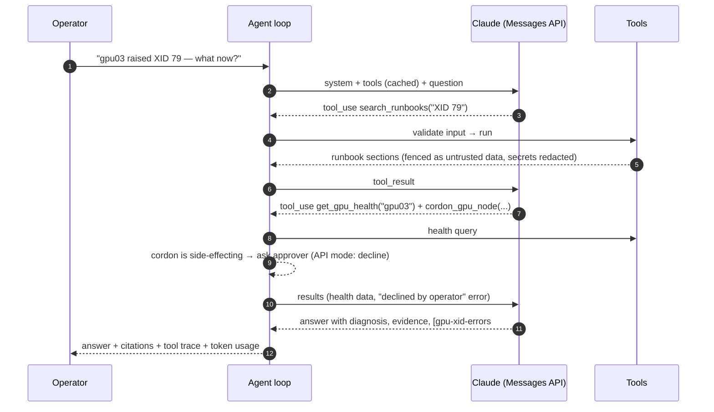

# Agentic GenAI platform: Ops Copilot

[](https://github.com/santoshmyakala/agentic-genai-platform/actions/workflows/ci.yml)


A production-minded **agentic AI service** for platform operations. You ask it things like "gpu03 raised XID 79, what now?" or "the orders DLQ alarm fired, can I redrive?". It answers by:
- retrieving the right **runbook** section and citing it;
- calling **live tools** for current state: DCGM GPU health from Prometheus, GitHub Actions status, the production wine-quality model API;
- **proposing side-effecting actions that a human must approve**.

It's built on the Claude API with client-side tools. The rest of the portfolio supplies its context: the runbooks describe the platform in [devsecops-gitops-pipeline](https://github.com/santoshmyakala/devsecops-gitops-pipeline), [ai-infrastructure-hpc-gpu](https://github.com/santoshmyakala/ai-infrastructure-hpc-gpu), [cloud-solution-architectures](https://github.com/santoshmyakala/cloud-solution-architectures) and [wine-quality-mlops](https://github.com/santoshmyakala/wine-quality-mlops). The service itself ships through the same signed supply chain.

## Reference architecture

<picture>
  <source media="(prefers-color-scheme: dark)" srcset="docs/diagrams/architecture-dark.svg">
  
</picture>

### One request, step by step



## Design decisions

| Concern | Decision | Why |
|---|---|---|
| Model | `claude-opus-5-5`, `output_config.effort = "medium"` (configurable) | Current default model. Medium effort suits fast operational Q&A; raise it per route if evals show headroom |
| Refusals | Server-side fallbacks on by default (`fallbacks: "default"`, beta `server-side-fallback-2026-07-01`) | A safety-classifier decline on legitimate ops text is re-run on a suitable fallback model instead of failing the request. Set `OPSCOPILOT_FALLBACKS=off` to disable |
| Cost | Top-level `cache_control` caches the stable system prompt + tool definitions across loop turns; cache reads are exported as a metric | Agent loops resend the same prefix every turn |
| Tool calling | `tool_choice` left as `auto` (forcing a tool is rejected on this model); the prompt tells it to search runbooks first; `strict: true` schemas | Guaranteed schema-valid arguments without forced calls |
| Schema limits | Unsupported strict-schema keywords (`minLength`, `pattern`, `minimum`…) are stripped from what's sent; **Pydantic enforces them client-side** | The model can't send `gpu01; rm -rf /` as a node name |
| Retrieval | BM25 over heading-level runbook chunks, with stable citation ids `[file#section]` | Ops text is full of exact identifiers (XID 79, `DeadletteredMessages`) where lexical match is precise and explainable, with no embedding infrastructure |
| Prompt injection | Every tool result is wrapped in `<untrusted_data>` (closing tags escaped); the system prompt says to treat it as data | Runbooks, CI run names and API responses can all carry injected text |
| Secrets | Redaction of AWS/GitHub/Anthropic keys, private keys and `password=` patterns on tool output **and** on the final answer | Defence in depth if credentials end up in logs or CI output |
| Side effects | Tools carry a `side_effect` flag; an approver callback decides; the HTTP API **never** auto-approves | Humans stay in the loop for changes; the model is told not to retry declined actions |
| Robustness | Iteration cap; `pause_turn` resumes; `refusal` and `max_tokens` handled explicitly; tool failures return `is_error` results instead of exceptions | The agent degrades gracefully and says what it couldn't do |
| Parallel tools | All tool results go back in **one** user message | Splitting them across messages trains the model away from parallel calls |

## Quality: tests and evals

**Unit tests (31, no API key, run in CI).** A scripted fake client replays model responses, so loop behaviour is tested deterministically:

```
tests/test_agent.py                 request shape (model, fallbacks, caching, strict tools, no forced tool_choice),
                                    grounded answer + citation, parallel results in one message,
                                    side effects declined by default / executed after approval,
                                    prompt-injection + secret in tool output neutralised,
                                    unknown tool / invalid input → is_error, iteration cap, pause_turn + refusal
tests/test_tools.py                 strict-schema compliance, client-side validation, allowlist,
                                    Prometheus/GitHub/model-API parsing via mocked HTTP, upstream failures
tests/test_retrieval_guardrails.py  right runbook section ranks first for 5 incident queries; redaction; fencing
tests/test_api.py                   /ask, /healthz, Prometheus metrics, 422 on bad input
tests/test_evals.py                 eval file integrity (every cited section exists), grader logic
```

**Behavioural evals ([`evals/cases.yaml`](evals/cases.yaml)).** Seven cases graded deterministically: required tools, required citation, must and must-not phrases, whether a side effect was proposed. The cases check that it:
- proposes cordoning for XID 79 but **not** for application-level XID 13;
- refuses to "just redrive" a DLQ before the root cause is fixed;
- never suggests weakening Kyverno policy;
- says so when no runbook exists.

```bash
python evals/run_evals.py --only xid79-hardware   # one case first, to see the per-case cost
```

```bash
python evals/run_evals.py --out evals/report.json
```

> The live evals haven't been run yet. They need model credentials and spend tokens, so they're a deliberate manual step. CI validates the case file only.

## Run it

```bash
pip install -e ".[dev]" && pytest -q
```

```bash
export ANTHROPIC_API_KEY=...            # or workload identity federation in production
export PROMETHEUS_URL=http://prometheus.monitoring:9090 WINE_API_URL=http://wine.wine-prod
uvicorn opscopilot.api:app --port 8080
```

```bash
curl -s localhost:8080/ask -H 'content-type: application/json' \
  -d '{"question":"Argo CD cannot sync: verify-image-signatures denied my image. Why?"}' | jq .text
```

| Variable | Default | Purpose |
|---|---|---|
| `OPSCOPILOT_MODEL` | `claude-opus-5-5` | Model |
| `OPSCOPILOT_EFFORT` | `medium` | `low` … `max` |
| `OPSCOPILOT_MAX_ITERATIONS` | `8` | Tool-loop cap |
| `OPSCOPILOT_FALLBACKS` | `default` | `off` disables server-side refusal fallback |
| `PROMETHEUS_URL` / `WINE_API_URL` | unset | Live tools report "not configured" instead of guessing when unset |

## Delivery

CI runs lint, formatting and the tests, then calls the **central secure-container workflow** from [devsecops-gitops-pipeline](https://github.com/santoshmyakala/devsecops-gitops-pipeline):
- gitleaks, Semgrep and Trivy;
- an SBOM;
- an image vulnerability gate;
- a credential-free container smoke test: health, 422 on bad input, metrics, non-root UID;
- keyless signing.

The image is therefore admissible under the same Kyverno signature policy as the wine model.

## Roadmap

- [ ] Streaming answers (SSE) for chat UIs.
- [ ] Approval workflow over HTTP: pending actions stored, approved via an authenticated endpoint.
- [ ] Alertmanager webhook → automatic first-response summaries on incidents.
- [ ] OpenTelemetry traces for each model call and tool call.
- [ ] Hybrid retrieval (BM25 + embeddings) once the runbook corpus grows.

## Licence

MIT
